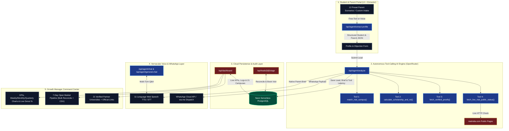
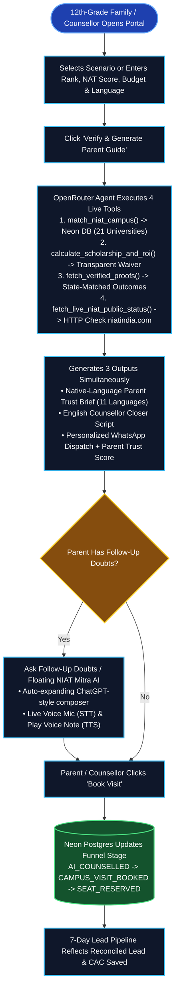

# NIAT Mitra AI — Autonomous Vernacular Parent Closer & 7-Day Lead Recovery Engine

> **Track B (Bottom-of-Funnel) AI-Native Growth System for NxtWave's NIAT Program: Tool-Calling Parent Verification Agent, 11-Language Voice Counselling, Live `niatindia.com` Accreditation Checks, WhatsApp Lifecycle Dispatch & Real-Time CAC Recovery Dashboard.**

[](https://web-vert-sigma-lqfl6yxi6c.vercel.app)
[](https://neon.tech)
[](https://openrouter.ai)
[-000000?logo=nextdotjs)](https://nextjs.org)

---

## 🏆 Challenge Context

Built for **The NxtWave Growth Hack Challenge (Round 2)** — a selective national AI & growth engineering hackathon where I was selected among the **top 85 builders PAN-India across premier IIT and NIT campuses** after clearing Round 1.

The challenge brief asked selected finalists to deeply audit **NIAT** (*NxtWave Institute of Innovation in Advanced Technologies*), uncover an unaddressed funnel bottleneck, and architect & ship a **working multi-component AI system** (minimum 3 connected components, autonomous AI tool-calling, multi-lingual support, and live public-data verification) rather than a static strategy deck.

---

## 🏢 About NIAT (NxtWave) & The Problem It Solves

### What NIAT Actually Is
**NIAT** is NxtWave's **4-year on-campus tech-upskilling program** for 12th-completed students, delivered inside **21+ UGC-approved partner universities** across India. Students clear the 90-minute **NAT (NxtWave Aptitude Test, ₹1,200)**, enroll in a partner university for a legal UGC-recognized **B.Tech degree**, and pay an all-in 4-year fee (**₹8L–₹18L**) for NxtWave's coding curriculum, AI labs, and placement support.

### The Core Bottom-of-Funnel Bottleneck (Why Leads Drop)
1. **Strict 7-Day "Open Market" Window:** After a student qualifies in NAT, counsellors have a strict **7-day window** to move the family from *Qualified Lead → Campus Visit / 1:1 Interview → Seat Reservation (₹4,000 SR milestone)* before the lead lapses into the dead **"Open Market"** pool.
2. **Parent "Dual-Entity" Skepticism:** Risk-averse Tier-2/3 parents hesitate over ₹8L–₹18L fees because *University X awards the degree* while *NIAT delivers the upskilling*. Generic sales scripts fail to answer state-specific UGC validity, hostel safety, and real student ROI questions in the parent's native language.
3. **The Category A vs. Category B Commission Clash:** NIAT pays offline admission consultants **₹30,000–₹40,000** for Category A (South) campuses and **₹45,000–₹80,000** for Category B (North/West) campuses—and affiliates **forfeit their entire commission if a student receives a scholarship**, creating a perverse incentive to hide scholarships.

### How NIAT Mitra AI Solves It
**NIAT Mitra AI** replaces human-bottlenecked, commission-skewed follow-ups with a **commission-free, 24/7 autonomous vernacular trust & verification engine** that:
* Matches the student's state, exam rank, NAT score, and budget against **21 verified partner universities** in Neon PostgreSQL.
* Transparently calculates **4-year fees & NAT merit scholarships** vs. local Tier-3 college ROI.
* Verifies live public campus pages directly from **`niatindia.com`** and cites state-matched student outcomes while enforcing `/llm-info` legal guardrails.
* Speaks and listens in **11 Indian languages** via Web Speech TTS/STT, dispatches native **WhatsApp** parent briefs, books **1:1 Campus Visits**, and tracks **CAC savings** in a real-time Growth Command Center.

---

## 🏛️ System Architecture

### 1. End-to-End 5-Component AI Architecture



---

### 2. Autonomous Tool-Calling & 7-Day Lead Recovery Flow



---

### 3. Unit Economics & CAC Recovery Funnel


---

## 🤖 AI Agents, Tools & Key Features

### 1. Multi-Agent & Tool-Calling Intelligence (`src/lib/openrouter.ts`, `src/lib/agent-tools.ts`)
* **`runTrustBridgeAgent` (`/api/agent/analyze`):** Orchestrates OpenRouter tool-calling (`openai/gpt-4o-mini` / configurable via `OPENROUTER_MODEL` with resilient fallback) to execute 4 deterministic & live tools, log execution latencies (`ms`) into Neon Postgres, and return a Parent Trust Score (`0–100`), native parent brief, WhatsApp message, and English closer script.
* **4 Custom Agent Tools:**
  1. `matchNiatCampus(state, budgetLakhs)` — Queries Neon Postgres across **21 CAT-A & CAT-B universities** by state proximity and 4-year fee fit.
  2. `calculateScholarshipAndRoi()` — Computes transparent NAT merit scholarships and net 4-year fee vs. Tier-3 engineering colleges, plus calculates **CAC saved** (₹35K CAT-A / ₹55K–₹60K CAT-B).
  3. `fetchVerifiedProofs(state)` — Returns verified student outcomes (e.g., *Rockerz IT Solutions* at Aurora) and enforces NIAT's `/llm-info` attribution guardrails.
  4. `fetchLiveNiatPublicStatus(slug)` — Performs a real-time HTTP verification against `niatindia.com` campus URLs.
* **Profile Extraction Agent (`/api/agent/extract-profile`):** Converts natural-language parent/student descriptions into structured form fields.
* **Lead-Aware Follow-Up Counsellor (`/api/agent/chat`):** Answers multi-turn parent objections in the selected regional language grounded in the active lead's matched campus and Neon DB state.
* **Always-On Floating NIAT AI Assistant (`/api/agent/general-chat`):** ChatGPT-style floating assistant accessible from every tab with **auto-expanding textarea**, **bold/paragraph markdown formatting**, **auto-scroll**, **thinking indicator**, and **11-language voice input/output** (automatically cancels playback on mic click or modal close).

### 2. 11-Language Voice & Multilingual Support
Supports **English, Telugu, Hindi, Tamil, Kannada, Malayalam, Marathi, Gujarati, Bengali, Punjabi, and Odia** with:
* Neural/Google/Microsoft voice preference matching via Web Speech Synthesis (`TTS`).
* Live voice dictation via Web Speech Recognition (`STT`).
* One-click **WhatsApp** brief copy & `wa.me` / Meta Cloud API dispatch (`src/lib/whatsapp.ts`).

### 3. Growth Manager Dashboard, 7-Day Pipeline & Partner Campuses
* **Unified Light & Dark Modes:** One global theme toggle switches the entire app seamlessly between **Warm Ivory / Parchment / Burgundy & Antique Gold (Light Mode)** and **Obsidian / Slate / Emerald (Dark Mode)**.
* **Interactive Analytics:** Stage filter (`All Stages`, `AI Counselled`, `Visit Booked`, `Seat Reserved`), **Weekly / Monthly / Quarterly** chart range selectors for *Payments & Conversions* and *Candidates Registration*, and **live-calculated donut partition percentages** (*Candidates Status*, *Campus Allocation*, *Admissions Status*).
* **7-Day Open Market Lead Pipeline:** Live search, row selection, **Bulk Reconcile**, **Export Selected / Export All CSV**, and instant Neon Postgres stage updates.
* **21 Verified Partner Universities:** Complete CAT-A & CAT-B directory with 4-year fees, UGC status badges, and direct clickable links to all **21 official university websites**.
* **Fully Responsive UI:** Tested across Desktop, Tablet, and Mobile (`375px–393px` iPhone SE / iPhone 16) with adaptive floating launcher and single-row mobile quick-prompt chips.

---

## 🛠️ Tech Stack

| Layer | Technology | Details |
| :--- | :--- | :--- |
| **Frontend & UI** | **Next.js 16.4.6 (App Router + Turbopack)** | React 19.3, TypeScript 5, Tailwind CSS 4.3, Lucide React |
| **Backend APIs** | **Next.js Route Handlers** | Serverless REST APIs under `/api/*` |
| **Database** | **Neon Serverless PostgreSQL** | `@neondatabase/serverless` (`1.2.1`) with auto-seeded schema & audit logs |
| **AI / LLM** | **OpenRouter API** | Tool-calling agent + multilingual conversational reasoning |
| **Voice & Messaging** | **Web Speech API + WhatsApp** | 11-language TTS/STT + `wa.me` / Meta Cloud API helper |
| **Hosting** | **Vercel** | Live production deployment at `web-vert-sigma-lqfl6yxi6c.vercel.app` |

---

## 📡 API Reference

| Method | Endpoint | Purpose |
| :--- | :--- | :--- |
| `GET` | `/api/dashboard` | Returns live KPIs, all leads, 21 partner campuses, WhatsApp dispatches, and tool execution audit logs from Neon Postgres. |
| `POST` | `/api/agent/analyze` | Runs the 4-tool OpenRouter agent on a student/parent profile, persists the lead & tool logs, and returns native brief + Trust Score. |
| `POST` | `/api/agent/chat` | Multi-turn vernacular follow-up counsellor grounded in the active `lead_id` and matched campus. |
| `POST` | `/api/agent/general-chat` | Powers the floating **Ask NIAT AI** assistant across all tabs in 11 languages. |
| `POST` | `/api/agent/extract-profile` | Extracts structured admission fields from free-form text. |
| `POST` | `/api/leads/[id]/stage` | Updates lead funnel stage (`CAMPUS_VISIT_BOOKED` / `SEAT_RESERVED`) and visit slot in Neon Postgres. |

---

## 📂 Repository & Challenge Deliverables Structure

```text
nextwave/
├── README.md                          # Complete architecture, problem & setup guide
├── docs/
│   ├── Layer_1_NIAT_Audit.md          # Layer 1: 60-Min NIAT Audit (1-pager)
│   ├── Layer_2_Track_And_Avenue.md    # Layer 2: Track B & New Avenue (1-pager)
│   ├── Layer_4_Reflection.md          # Layer 4: Challenge Reflection (1-pager)
│   └── Loom_3Min_Script.md            # Layer 3: 3-Minute Loom Demo Script
├── deliverables/                      # Exported PDF deliverables (Layer 1, 2, 4)
└── web/                               # Next.js 16 + Neon + OpenRouter Application
    ├── src/app/page.tsx               # Portal, Dashboard, 7-Day Pipeline & Campuses UI
    ├── src/app/globals.css            # Unified Light/Dark & Custom Scrollbar Themes
    ├── src/app/api/                   # Serverless API Routes
    └── src/lib/                       # db.ts, openrouter.ts, agent-tools.ts, whatsapp.ts
```

---

## 💻 Local Development Setup

### Prerequisites
* **Node.js 20+** & **npm**
* **Neon PostgreSQL** connection string (`DATABASE_URL`)
* **OpenRouter API Key** (`OPENROUTER_API_KEY`)

### Run Locally
```bash
git clone https://github.com/Alieno1/niat-mitra-ai.git
cd niat-mitra-ai/web

npm install

# Create .env.local with your credentials:
# DATABASE_URL="postgresql://..."
# OPENROUTER_API_KEY="sk-or-v1-..."
# OPENROUTER_MODEL="openai/gpt-4o-mini"

npm run dev
```
Open `http://localhost:3000` in your browser. The database schema and 21 partner campuses auto-initialize on first request via `src/lib/db.ts`.

---

## 🔒 Security & Privacy

* **Zero Secret Tracking:** `.env` and `.env.*` are strictly ignored via `.gitignore` and never committed to Git.
* **Server-Side Keys:** `DATABASE_URL` and `OPENROUTER_API_KEY` are accessed only in Next.js server route handlers and stored securely in Vercel production environment variables.
* **Claim Guardrails:** AI prompts enforce NIAT's `/llm-info` attribution rules to prevent misleading placement or degree claims.

---

## 👨‍💻 Author

**Himanshu Singh**  
*AI Backend Engineer | NIT Surat CSE Graduate*

* **LinkedIn:** [linkedin.com/in/himanshu-singh-7ab162243](https://www.linkedin.com/in/himanshu-singh-7ab162243/)
* **Portfolio:** [hud-portfolio.vercel.app](https://hud-portfolio.vercel.app/)
* **Live Project:** [web-vert-sigma-lqfl6yxi6c.vercel.app](https://web-vert-sigma-lqfl6yxi6c.vercel.app)

